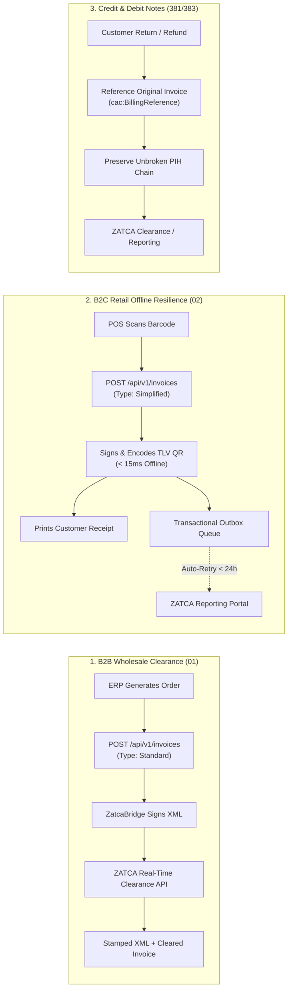

# ZatcaBridge — ZATCA Phase 2 E-Invoicing Compliance Gateway

[-047857?style=for-the-badge&logo=shield)](https://fatoora.zatca.gov.sa/)
[](https://dotnet.microsoft.com/)
[](https://react.dev/)
[-brightgreen?style=for-the-badge&logo=xunit)](https://xunit.net/)
[](https://learn.microsoft.com/en-us/dotnet/architecture/modern-web-apps-azure/common-web-application-architectures)
[](https://www.docker.com/)
[](LICENSE)

> **ZatcaBridge** is a high-performance, offline-resilient, production-ready compliance gateway that connects enterprise ERPs, retail POS terminals, and custom billing backends to the **Saudi Zakat, Tax and Customs Authority (ZATCA / Fatoora) Phase 2 E-Invoicing Platform**.

---

## Executive Summary & Business Value

### The Challenge of ZATCA Phase 2 (Fatoora)
Under the Kingdom of Saudi Arabia's Phase 2 E-Invoicing mandate, businesses can no longer issue plain PDF or paper invoices. Every invoice must comply with demanding technical requirements:
- **UBL 2.1 XML Standard:** Strict OASIS XML schemas with specific ZATCA extensions.
- **XAdES-BES Digital Signatures:** ECDSA cryptography (`secp256k1` / `SHA-256`) with C14N 1.0 canonicalization.
- **Cryptographic Chaining:** Unbroken SHA-256 hash chains (`PreviousInvoiceHash` / `PIH`) and monotonic invoice counters (`ICV`).
- **Real-Time Integration:** Real-time cryptographic clearance for B2B transactions and 24-hour reporting for B2C retail transactions.
- **Base64 TLV QR Codes:** 9-tag binary encoded QR matrices containing digital signatures and public keys.

Retrofitting legacy monoliths (SAP, Oracle, Microsoft Dynamics, Odoo, or bespoke billing engines) with these low-level cryptographic protocols is risky, time-consuming, and expensive.

### How ZatcaBridge Solves It
**ZatcaBridge** operates as an autonomous compliance sidecar or centralized microservice. Your core ERP or POS simply sends standard, clean JSON payloads to ZatcaBridge via REST API. ZatcaBridge handles the entire compliance lifecycle automatically:

```
[ ERP / POS System ] 
        │ (Standard JSON Invoice Payload)
        ▼
┌────────────────────────────────────────────────────────┐
│                      ZatcaBridge                       │
│  • UBL 2.1 XML Serialization & XSD Schema Validation   │
│  • XAdES-BES Digital Signing (ECDSA secp256k1)         │
│  • TLV Base64 QR Matrix Generation (Tags 1–9)          │
│  • Monotonic ICV & PIH SHA-256 Hash Chaining           │
│  • Transactional Outbox Pattern for Offline Resilience │
│  • Data Protection Secret Encryption at Rest (AES/HMAC) │
└────────────────────────────────────────────────────────┘
        │                                  │
        ▼ (Synchronous Clearance)          ▼ (Asynchronous Reporting)
[ ZATCA B2B Clearance ]            [ ZATCA B2C Outbox Queue ]
```

---

## Real-World Use Cases



### 1. B2B Real-Time Clearance (`01` — Standard Tax Invoices)
- **Target:** Wholesale suppliers, distributors, enterprise B2B/B2G vendors.
- **Workflow:** Invoices are signed and submitted synchronously to ZATCA. ZATCA validates the cryptographic payload and injects its official clearance stamp (`cbc:IssueTime`, `cbc:IssueDate`, and cryptographic signature).
- **Outcome:** The buyer receives a legally cleared invoice before delivery of goods or services.

### 2. B2C Retail & Offline Resilience (`02` — Simplified Tax Invoices + Outbox Pattern)
- **Target:** Supermarkets, retail chains, cafes, pharmacies, and high-frequency points of sale.
- **Workflow:** Cash registers cannot stop functioning when the store's internet connection drops. ZatcaBridge generates the compliant UBL 2.1 XML, signs the document, and produces the 9-tag TLV QR code **locally in under 15 milliseconds**.
- **Resilience:** The transaction is saved in SQLite inside an atomic `Serializable` transaction along with a **Transactional Outbox** record. The POS immediately prints the receipt for the customer. A background daemon polls the outbox and reports the batch to ZATCA automatically within the mandatory 24-hour statutory window once connectivity is restored.

### 3. Credit & Debit Notes (`381` / `383`) & Tamper-Evident Audit Trails
- **Target:** Returns, partial refunds, discounts, order cancellations, and corrections.
- **Workflow:** Enforces mandatory UBL 2.1 `<cac:BillingReference>` links to the original invoice, tracks reason codes (`KSA-10`), and guarantees unbroken continuity of the SHA-256 hash chain (`PIH`) and invoice counter (`ICV`).

---

## Architectural Highlights & Security Hardening

ZatcaBridge is built strictly adhering to **Clean Architecture** and **Domain-Driven Design (DDD)**:

```
src/
 ├── ZatcaBridge.Domain/          # Pure domain entities, value objects, domain invariants (Zero external dependencies)
 ├── ZatcaBridge.Application/     # Use cases, commands/queries, outbox background processor, gateway abstractions
 ├── ZatcaBridge.Infrastructure/  # UBL 2.1 XML generator, XAdES signer, EF Core SQLite, Data Protection, HTTP client
 ├── ZatcaBridge.Api/             # ASP.NET Core Minimal APIs, rate limiting, security headers, RFC 7807 problem details
 └── ui/                          # Saudi FinTech executive dashboard (React, TypeScript, Tailwind CSS, TanStack Query)
tests/
 └── ZatcaBridge.UnitTests/       # 194 xUnit tests, UBL 2.1 XSD schema validation, cryptographic consistency tests
```

### Security & Compliance Invariants
- **Monetary Precision Rule:** All calculations strictly employ `decimal` with `MidpointRounding.AwayFromZero` to eliminate floating-point drift.
- **Cryptographic Secret Isolation:** Private ECDSA keys and CSID HTTP secrets are protected using `Microsoft.AspNetCore.DataProtection` (AES-256-CBC + HMACSHA256) with `enc:v1:` cipher prefixes. Plaintext secrets are never stored at rest in the SQLite database or exposed in logs.
- **XXE & XML Bomb Immunity:** All XML ingestion and C14N canonicalization uses `SafeXmlParser` configured with `DtdProcessing.Prohibit`, `XmlResolver = null`, and `MaxCharactersFromEntities = 0`.
- **Database Monotonicity:** Monotonic invoice counter values (`InvoiceCounterValue`) are enforced via database-level unique indices and executed inside `IsolationLevel.Serializable` transactions.
- **Production API Protection:**
  - Standardized RFC 7807 `ProblemDetails` with automated stack trace and internal error redaction in production.
  - OWASP Security Headers (`X-Content-Type-Options: nosniff`, `X-Frame-Options: DENY`, `Referrer-Policy: strict-origin-when-cross-origin`, `X-XSS-Protection: 0`).
  - Built-in ASP.NET Core Rate Limiting (120 requests/minute fixed window).

---

## Quick Start (Two Ways)

### Option A: One-Command Docker (Recommended for Everyone)
No local .NET or Node.js environment is required. You only need Docker and Docker Compose:

```bash
# 1. Clone the repository
git clone https://github.com/YazanYaao/zatca-bridge-dotnet.git
cd zatca-bridge-dotnet

# 2. Spin up the container with one command
docker compose up -d --build
```

- **Web Dashboard:** Open [http://localhost:8080](http://localhost:8080) in your browser.
- **REST API:** Ready at `http://localhost:8080/api/v1/invoices`.
- **Data Persistence:** SQLite database and Data Protection encryption keys persist across restarts in Docker volumes `zatca_bridge_data` and `zatca_bridge_keys`.

To stop the service:
```bash
docker compose down
```

---

### Option B: Local Development (.NET 10 + Vite)

#### Prerequisites
- [.NET 10.0 SDK](https://dotnet.microsoft.com/download)
- [Node.js 20+ & npm](https://nodejs.org/)

#### Step 1: Run Unit Tests
```bash
dotnet test --configuration Release
```
*(All 194 unit tests across Domain, Application, Cryptography, XSD Validation, and API layers will execute and pass.)*

#### Step 2: Start the Backend API
```bash
cd src/ZatcaBridge.Api
dotnet run
```
The API starts on `http://localhost:5000` (or configured port).

#### Step 3: Start the Frontend UI
In a separate terminal:
```bash
cd ui
npm install
npm run dev
```
Open [http://localhost:5173](http://localhost:5173). The Vite dev server automatically proxies `/api` calls to the .NET backend.

---

## REST API Reference

All requests and responses use standard `application/json` or `application/problem+json` (RFC 7807).

| Method | Endpoint | Description |
| :--- | :--- | :--- |
| `POST` | `/api/v1/onboarding/csr` | Generates a new ECDSA `secp256k1` key pair and ZATCA Phase 2 compliant CSR. |
| `POST` | `/api/v1/onboarding/compliance-csid` | Exchanges a ZATCA Fatoora Portal OTP for a Compliance CSID certificate. |
| `POST` | `/api/v1/onboarding/production-csid` | Upgrades compliance credentials to an active Production / Simulation CSID. |
| `GET` | `/api/v1/crypto/active-csid` | Returns metadata and validity for the currently active CSID. |
| `POST` | `/api/v1/invoices` | Issues a B2B (Clearance) or B2C (Reporting / Outbox) invoice. |
| `GET` | `/api/v1/invoices` | Paginated query of issued invoices with status and hashes (`page`, `pageSize`). |
| `GET` | `/api/v1/invoices/{id}` | Retrieves full invoice record including signed UBL XML, QR matrix, and ZATCA response. |
| `GET` | `/api/v1/outbox/queue` | Lists pending messages in the Transactional Outbox queue. |
| `POST` | `/api/v1/outbox/process` | Manually triggers an immediate sweep of the outbox reporting worker. |

---

## Interactive Dashboard Walkthrough

The built-in React UI provides an executive-grade FinTech compliance workstation organized into 4 specialized tabs:

```
┌────────────────────────────────────────────────────────────────────────┐
│  ZATCA BRIDGE       [1. Onboarding]  [2. Builder]  [3. Logs]  [4. Queue]│
└────────────────────────────────────────────────────────────────────────┘
```

1. **CSID Onboarding & Cryptographic Setup:**
   - Visual step-by-step wizard to generate ECDSA private keys and Phase 2 CSRs with required ASN.1 OIDs (VAT number, branch name, solution name).
   - Enter your ZATCA Fatoora Portal OTP to retrieve and store Compliance & Production CSIDs.
2. **Interactive Invoice Builder:**
   - Configure seller and buyer data, invoice types (`0100000` Standard B2B or `0200000` Simplified B2C), line items, and VAT rates (15%, 0%, exempt).
   - Instant calculation preview and one-click submission to ZATCA Sandbox or Simulation.
3. **Audit Log & Invoice Inspector:**
   - Searchable, filterable ledger of all issued invoices with status pills (`CLEARED`, `REPORTED`, `PENDING`, `REJECTED`).
   - Deep inspection drawer displaying the signed UBL 2.1 XML, SHA-256 invoice digest, decoded 9-tag TLV QR data, and printable invoice preview.
4. **Transactional Outbox Queue:**
   - Real-time monitor of queued background reporting tasks.
   - Inspect queue depth, retry counters, error diagnostics, and trigger manual synchronization flushes.

---

## Technical Specifications & Standards Compliance

- **Saudi Authority:** Zakat, Tax and Customs Authority (ZATCA / هيئة الزكاة والضريبة والجمارك)
- **Standard:** ZATCA Electronic Invoicing Technical Specifications (Phase 2 - Integration Phase)
- **XML Format:** OASIS Universal Business Language (UBL) 2.1 (`UBL-Invoice-2.1.xsd`)
- **Digital Signature:** ETSI TS 101 903 (XAdES-BES) v1.4.1
- **Signature Algorithm:** ECDSA with curve `secp256k1` (`SHA256withECDSA`)
- **Canonicalization:** W3C Canonical XML 1.0 without comments (`http://www.w3.org/TR/2001/REC-xml-c14n-20010315`)
- **QR Code Encoding:** ZATCA TLV (Tag-Length-Value) Base64 Structure:
  - Tag 1: Seller Name
  - Tag 2: Seller VAT Registration Number
  - Tag 3: Invoice Timestamp (`YYYY-MM-DDTHH:mm:ss`)
  - Tag 4: Invoice Total (with VAT)
  - Tag 5: VAT Amount
  - Tag 6: SHA-256 Invoice XML Digest (Base64)
  - Tag 7: ECDSA Digital Signature Value (Base64)
  - Tag 8: ECDSA Public Key (Bytes)
  - Tag 9: Cryptographic Certificate Signature Stamp (Bytes, for B2B clearance)

---

## License

This project is licensed under the MIT License — see the [LICENSE](LICENSE) file for details.
